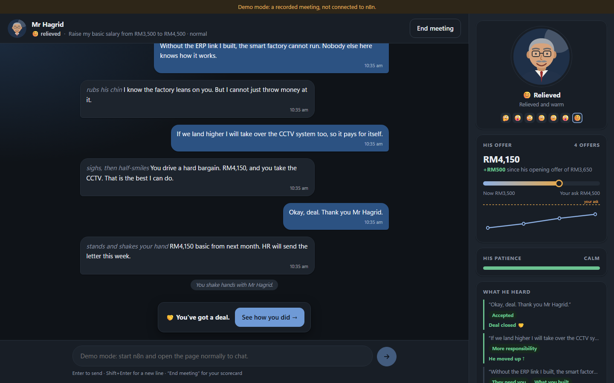
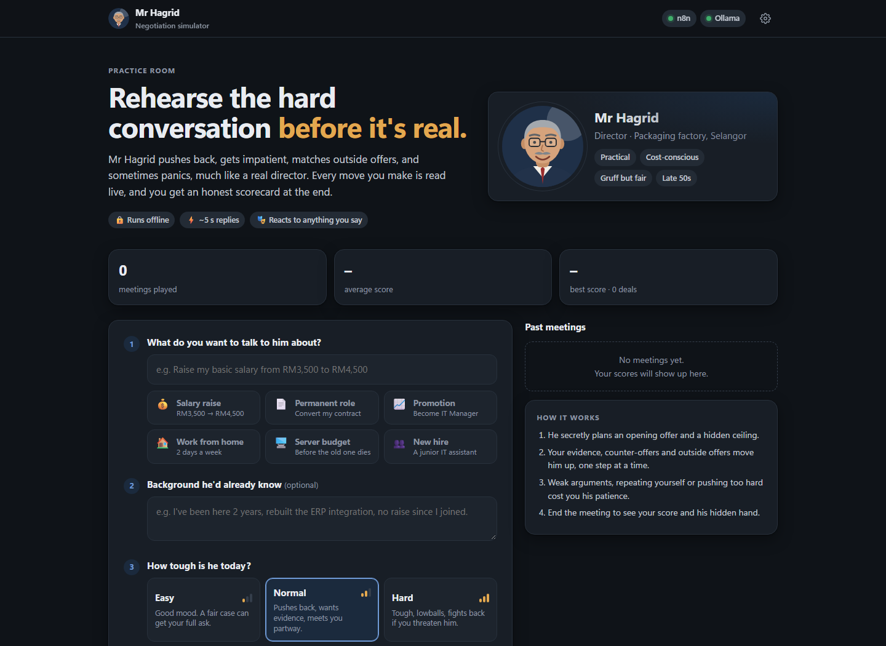
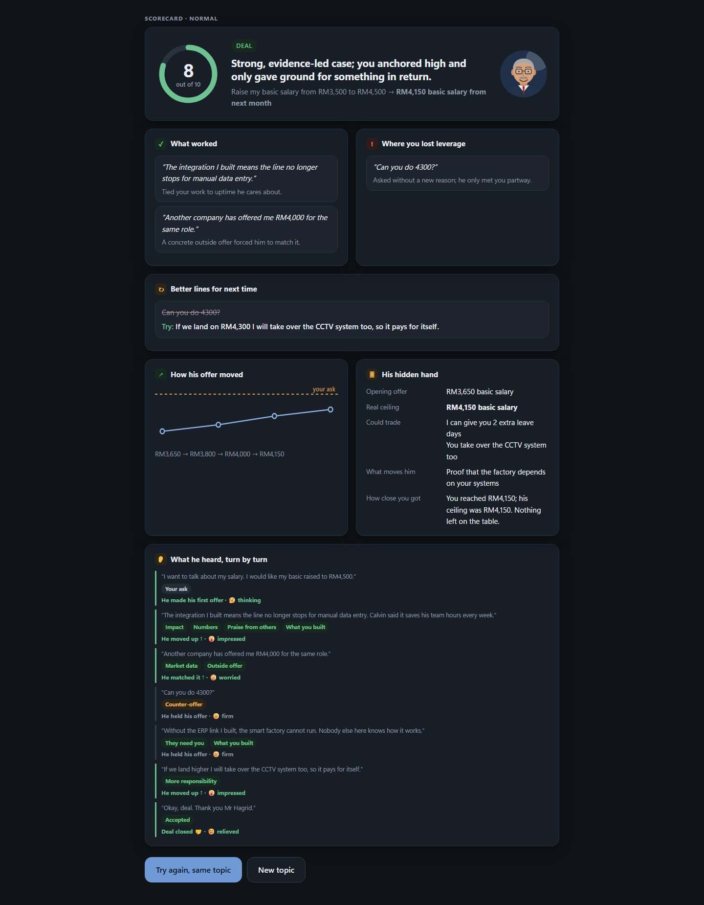
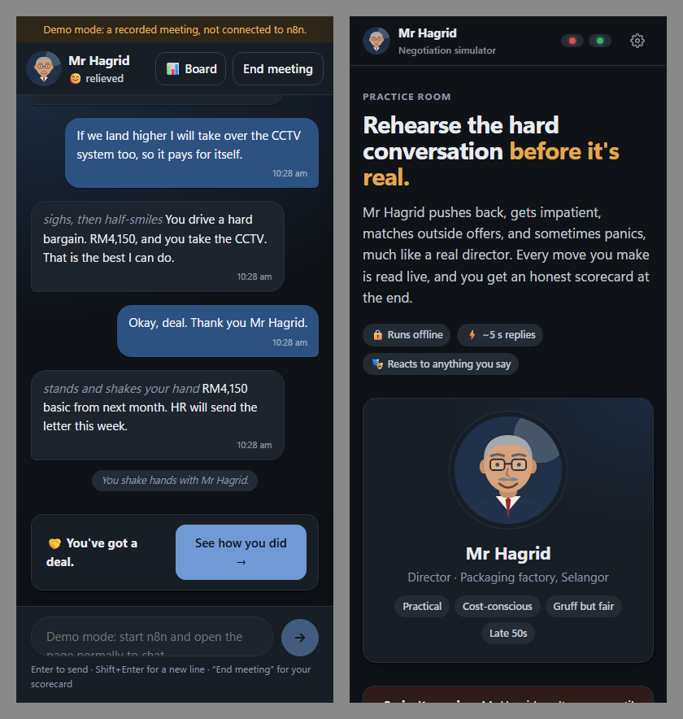
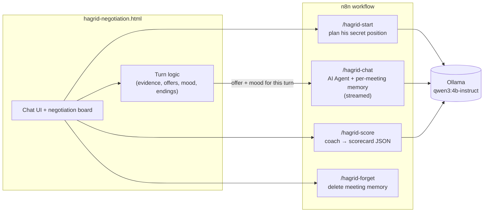

# Mr Hagrid · Negotiation Simulator

Rehearse a hard conversation with your boss before the real one. Mr Hagrid pushes back, gets impatient, matches outside offers, and reacts to anything you say. Every move you make is read live, and you get an honest scorecard at the end.

Everything runs **on your own machine**: a local LLM through [Ollama](https://ollama.com) and the workflow engine [n8n](https://n8n.io). Nothing is sent to the cloud.



## Features

- **A real counterpart, not a chatbot.** Short spoken replies, small actions (*leans back*, *sets down his pen*), hesitations, and an illustrated portrait whose face changes with his mood.
- **Live negotiation board.** His current offer, a progress bar from your current pay to your ask, a chart of how the offer moved, his patience, a mood timeline, and **what he heard** in each of your messages (market data, more responsibility, weak argument, and so on). It never reveals his hidden ceiling.
- **Moves that work like they do in real life.** Concrete evidence, outside offers, counter-offers and walk-away threats move him; repeating yourself, "cost of living" and rudeness don't.
- **Three difficulty levels.** Easy can get your full ask. Normal meets you partway. Hard lowballs and fights back if you threaten him.
- **Any topic, free chat.** Salary, promotion, work from home, budgets, or anything else. Off-topic talk gets an in-character reply without disturbing the negotiation.
- **Scorecard.** Your score out of 10, what worked, where you lost leverage, better lines to use, how his offer moved, his hidden hand, and a turn-by-turn replay.
- **Fast on modest hardware.** About 3 to 5 seconds per streamed reply on a GTX 1650 (4 GB) with `qwen3:4b-instruct`.

| Lobby | Scorecard | Phone |
|---|---|---|
|  |  |  |

Try it without installing anything: open `hagrid-negotiation.html?demo=1` (a recorded meeting) or `?demo=score` (a sample scorecard).

## Quick start (Windows)

1. Install the two dependencies once:
   ```
   winget install Ollama.Ollama
   npm install -g n8n
   ```
2. Import `hagrid-negotiation-workflow.json` into n8n and publish it, or run `bash build/deploy.sh` (see below).
3. Double-click **`start-hagrid.cmd`**. It:
   - starts Ollama and downloads the model the first time (about 2.5 GB)
   - starts n8n in its own window
   - waits until the workflow answers, warms up the model, and opens the page

Keep the "n8n - Mr Hagrid" window open while you practise. The lobby shows green lights when n8n and Ollama are reachable.

> **n8n credential:** the workflow uses an Ollama credential with base URL `http://127.0.0.1:11434`. Use `127.0.0.1`, not `localhost`: Node resolves `localhost` to IPv6 `::1`, but Ollama only listens on IPv4.

## How it works



A 4-billion-parameter model is fast, but it can't reliably judge "was that a strong argument?" or stick to a budget. So **code makes the decisions and the model does the talking**:

1. **Secret position.** At the start, the model plans four offers from worst to best. Code then enforces the rules: money offers are clamped to a range set by difficulty, steps are evenly spaced, and no offer exceeds what you asked for.
2. **Turn logic** (in the page, between the `<offer-logic>` markers):
   - Reads your message for new evidence: impact, numbers, dependency, praise from others, market data, what you built, his past promises, extra responsibility, walk-away threats.
   - Decides what Hagrid does this turn: first offer, improve, match an outside offer, meet you halfway, hold, last-chance offer, close the deal, or end the meeting.
   - Also sets his mood: pleased, impatient, worried, offended, nervous, and so on.
3. **The model only phrases it.** Each message to the model carries a short private note ("improve your offer to RM3,850", "hold, push back by mentioning fairness to the other staff"). Hagrid only ever sees his current and next offer, so he can't leak his ceiling.

| Difficulty | Moves needed per step | Counter-offers | Ceiling (money) |
|---|---|---|---|
| Easy | 1 strong point | every counter meets you partway | up to your full ask |
| Normal | 1, then 2 per step | every 2nd counter | about 50–75% of the gap |
| Hard | 2 per step | never on their own | about 20–45% of the gap |

## Project layout

```
hagrid-negotiation.html          the app (UI, negotiation board, turn logic)
hagrid-negotiation-workflow.json the n8n workflow (generated, don't edit by hand)
start-hagrid.cmd                 one-click launcher for Windows
build/
  shared.js chat.js start.js score.js parse.js   sources of the workflow's Code nodes
  build.js       assembles the workflow JSON and stamps the version into both files
  test-logic.js  50 regression tests built from real practice chats
  deploy.sh      test → build → back up n8n → import → publish
  version.txt    shared version; the page warns if n8n runs a different one
docs/screenshots/                README images
legacy/                          the original v1 single-prompt chat workflow
```

## Development

```bash
node build/test-logic.js     # run the turn-logic tests
node build/build.js hagrid-negotiation-workflow.json
bash build/deploy.sh         # with n8n stopped: tests, build, backup, import, publish
```

After deploying, start n8n again (or run `start-hagrid.cmd`) and press **Ctrl+F5** on the page. If the page and the workflow versions differ, the chat shows a warning.

## Troubleshooting

| Symptom | Fix |
|---|---|
| Red n8n light / "Can't reach n8n" | Run `start-hagrid.cmd`, or `n8n start` with `WEBHOOK_URL=http://localhost:5678`. |
| n8n prints an old ngrok URL | A stale `WEBHOOK_URL` is set in your Windows session. Sign out and in, or use the launcher (it overrides it). |
| "Version mismatch" in the chat | Re-deploy the workflow, then press Ctrl+F5. |
| First reply takes 20–60 s | The model is loading. The launcher warms it up; later replies take a few seconds. |
